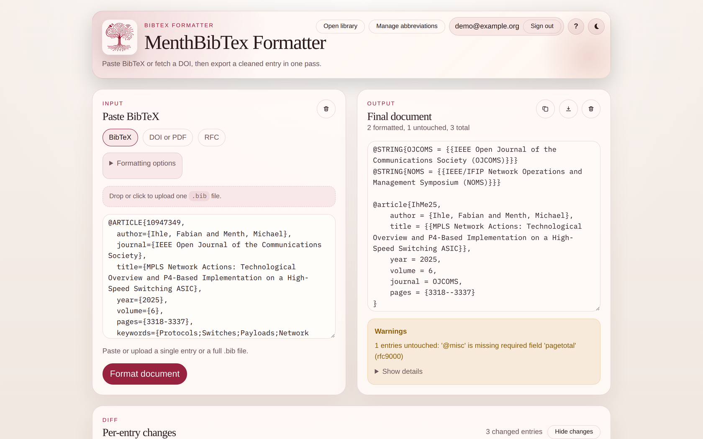
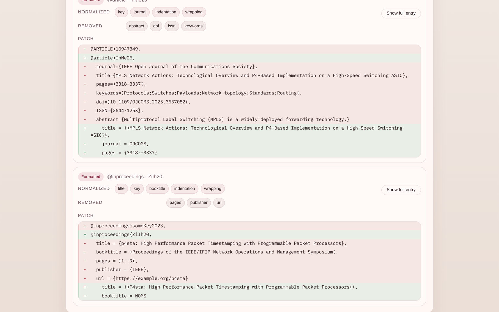
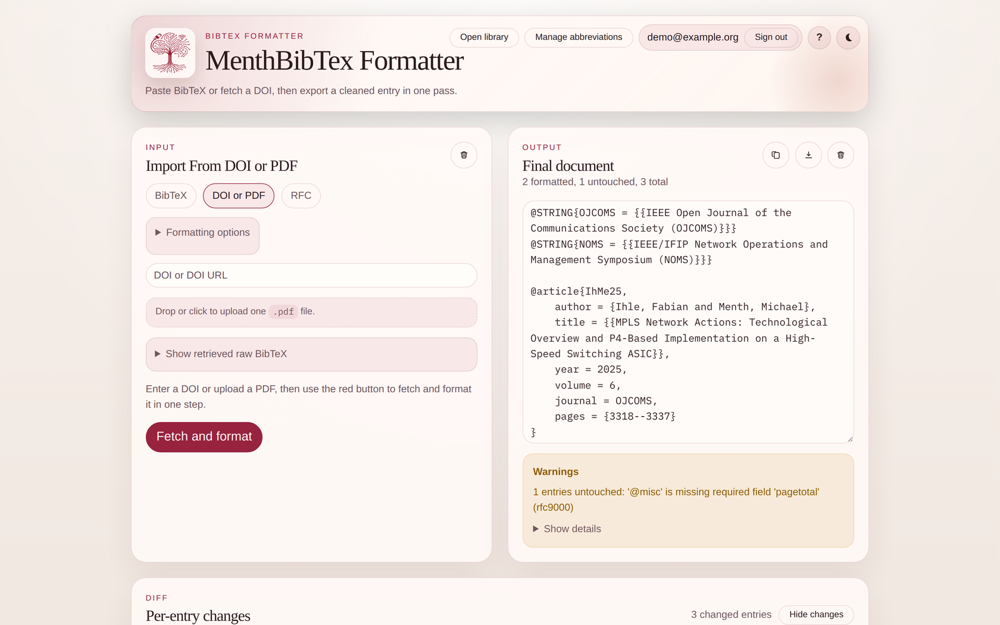
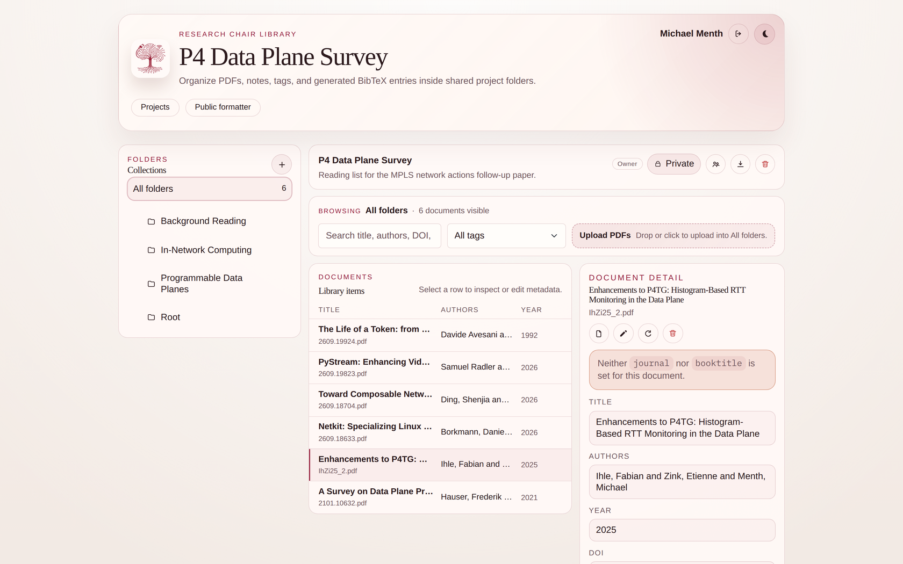
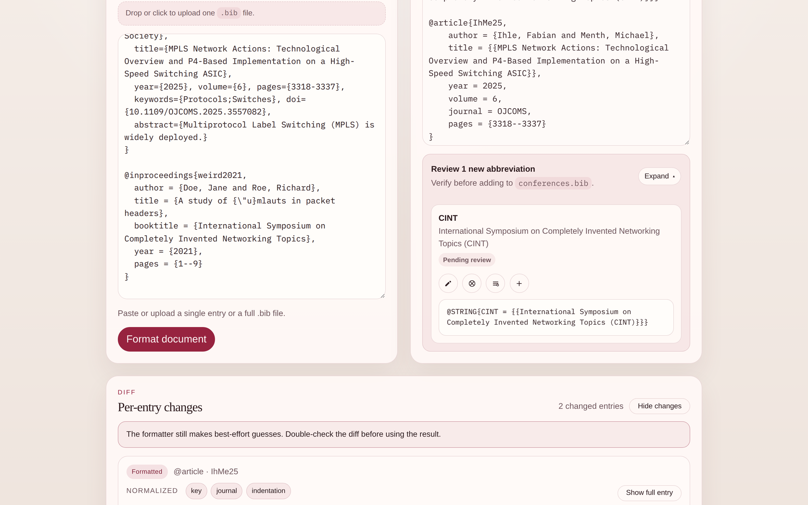
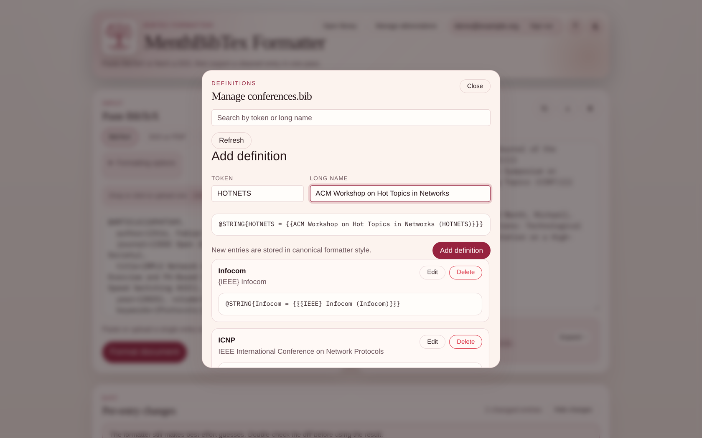

<div align="center">


# menthTex

### Paste a messy BibTeX entry. Get the lab's house style back.

[](https://github.com/n1tr0-5urf3r/menthTex/actions/workflows/ci.yml)
[](LICENSE)


A self-hosted BibTeX normalizer and literature workspace for research groups.

**[Try the hosted instance →](https://atlas.cs.uni-tuebingen.de/menthtex/)**

</div>



## Why

Every paper repository accumulates the same mess: citation keys in five different
conventions, conference names spelled out in full one time and abbreviated the
next, `abstract` and `keywords` fields nobody wants in the PDF, and title case
that depends on which publisher exported the entry.

menthTex takes that input and emits one consistent style — and because the venue
abbreviations live in a shared `conferences.bib`, the whole group converges on
the same `@STRING` tokens instead of each author inventing their own.

## What you get

- **One-pass normalization** — paste an entry or a whole `.bib` file and get back
  a clean document: regenerated citation keys, double-braced title case,
  normalized months and page ranges, and a strict field allowlist that drops
  `abstract`, `keywords`, `url`, `publisher`, and friends.
- **A managed abbreviation registry** — journal and booktitle names resolve
  against a shared `conferences.bib`. Known venues render as their `@STRING`
  token; unknown ones become a reviewable proposal with similarity suggestions,
  so a typo never silently becomes a new abbreviation. Signed-in users curate
  the registry — add, edit, delete — from the UI. See
  [Shared venue abbreviations](#shared-venue-abbreviations).
- **Four ways in** — paste/upload BibTeX, resolve a DOI, resolve an RFC number
  via Datatracker, or drop in a PDF and let `pdfinfo`/`pdftotext` plus Crossref,
  OpenAlex, and Semantic Scholar reconstruct the metadata.
- **A diff you can actually review** — every entry shows what changed and which
  fields were removed, because the formatter is deliberately opinionated and you
  should check it before it lands in a paper.
- **Literature workspace** — an authenticated area at `/app` with projects,
  folder trees, PDF storage, notes, automatic and manual tags, full-text search
  and filters, role-based sharing (viewer / editor / owner), and one-click
  BibTeX export of a whole project.
- **Safe by construction** — unsupported entry types, `@STRING`, and `@comment`
  pass through byte-for-byte. The formatter never rewrites what it does not
  understand, and never persists a venue proposal on its own.
- **SSO** — GitLab OAuth and/or Authentik OIDC, with login-time group
  enforcement. Configure neither and the public formatter still works standalone.

<table>
  <tr>
    <td></td>
    <td></td>
  </tr>
  <tr>
    <td align="center"><strong>Per-entry diff before you commit</strong></td>
    <td align="center"><strong>DOI, RFC and PDF lookup</strong></td>
  </tr>
  <tr>
    <td colspan="2"></td>
  </tr>
  <tr>
    <td colspan="2" align="center"><strong>Literature workspace: projects, folders, tags, notes</strong></td>
  </tr>
</table>

## Quick start

The production image bundles the React frontend, the Rust API, and
`poppler-utils` for PDF extraction. PostgreSQL and the PDF volume come from
Compose.

```sh
cp .env.example .env
# Optional: fill in GitLab and/or Authentik credentials to enable /app.
docker compose up --build
curl http://localhost:4242/api/health
```

Open <http://localhost:4242>. Without an auth provider you get the public
formatter; with one you also get the workspace at `/app`.

If you only want to format a `.bib` file and do not need your own registry or
workspace, the hosted instance at
<https://atlas.cs.uni-tuebingen.de/menthtex/> works without any setup.

To change the external port, edit only the left side of the mapping:

```yaml
ports:
  - "8080:3000"
```

## What it does to your entries

Input, as exported by a publisher:

```bibtex
@ARTICLE{10947349,
  author={Ihle, Fabian and Menth, Michael},
  journal={IEEE Open Journal of the Communications Society},
  title={MPLS Network Actions: Technological Overview and P4-Based Implementation on a High-Speed Switching ASIC},
  year={2025},
  volume={6},
  pages={3318-3337},
  keywords={Protocols;Switches;Payloads;Network topology},
  doi={10.1109/OJCOMS.2025.3557082},
  ISSN={2644-125X},
  abstract={Multiprotocol Label Switching (MPLS) is ...}
}
```

Output:

```bibtex
@STRING{OJCOMS = {{IEEE Open Journal of the Communications Society (OJCOMS)}}}

@article{IhMe25,
    author = {Ihle, Fabian and Menth, Michael},
    title = {{MPLS Network Actions: Technological Overview and P4-Based Implementation on a High-Speed Switching ASIC}},
    year = 2025,
    volume = 6,
    journal = OJCOMS,
    pages = {3318--3337}
}
```

The key is built from two surname letters per author plus the last two year
digits; the journal collapsed to a shared `@STRING` token that the formatter
emits alongside the entry; the page range became a LaTeX `--`; and `keywords`,
`doi`, `ISSN`, and `abstract` are gone — with the diff view listing every
removed field so nothing disappears quietly.

### The rules, briefly

| Area             | Behavior                                                                                                                                                                            |
| ---------------- | ----------------------------------------------------------------------------------------------------------------------------------------------------------------------------------- |
| Citation keys    | Two surname letters from each of the first two authors + two year digits (`IhMe25`). One author drops the second fragment. Collisions get `_2`, `_3`, … Accents are transliterated. |
| Titles           | Title-cased and double-braced so LaTeX preserves capitalization.                                                                                                                    |
| Venues           | Resolved against `conferences.bib`; unknown long names become proposals, short abbreviation-like strings stay literal.                                                              |
| Pages            | Normalized to `--`. Trivial whole-paper conference ranges starting at page 1 are dropped; journal ranges are kept.                                                                  |
| Unicode          | Dashes in titles, authors, venues, and pages are rewritten for LaTeX. Accented letters pass through untouched.                                                                      |
| `@inproceedings` | Requires author, title, year, and booktitle.                                                                                                                                        |
| `@article`       | Requires author, title, and year. Without a journal it is emitted as `@misc`.                                                                                                       |
| RFCs             | RFC-like `@misc`/`@techreport` entries get a strict canonical shape. Other `@misc` entries are left byte-for-byte alone.                                                            |
| Anything else    | Unsupported types and entries missing required data pass through untouched, with a warning.                                                                                         |

Key rewriting defaults to **on**. Turn it off in the formatting options when the
entries are already referenced by `\cite{...}` somewhere.

## Shared venue abbreviations

`conferences.bib` is not sample data — it is live application state, and the
reason a group's `.bib` files converge instead of drifting. It holds the
`@STRING` definitions that map a venue's long name to its token:

```bibtex
@STRING{OJCOMS = {{IEEE Open Journal of the Communications Society (OJCOMS)}}}
@STRING{NOMS = {{IEEE/IFIP Network Operations and Management Symposium (NOMS)}}}
```

When the formatter meets a venue it already knows, it emits the token. When it
meets an unknown long name, it does **not** invent an abbreviation and move on.
It derives a candidate token, ranks up to three existing definitions that look
similar, and hands the whole thing back as a proposal marked *Pending review*:



From that card a signed-in user can accept the proposal, edit the token or long
name first, pick one of the suggested existing definitions instead, or reject it
and keep the venue name literal. The similarity suggestions are the point: they
are what stops `Proc. of INFOCOM` from becoming a second abbreviation next to
`Infocom`.

Formatting **never** writes to `conferences.bib`. Persisting a definition is
always a separate, authenticated action.

Signed-in users also get a full registry editor under **Manage abbreviations** —
search, add, edit, and delete, with a live preview of the canonical `@STRING`
line that will be written:



| Endpoint | Auth | Purpose |
| -------- | ---- | ------- |
| `GET /api/definition-options` | none | Read the registry; used by the formatter UI |
| `GET /api/definitions` | session | List definitions for the manager |
| `POST /api/definitions` | session | Create a definition |
| `PUT /api/definitions/{token}` | session | Rename or re-expand a definition |
| `DELETE /api/definitions/{token}` | session | Remove a definition |
| `POST /api/add-definition` | session | Accept a proposal straight from the formatter |

Writes are serialized by an in-process mutex and rewrite the file in canonical
style. That mutex does **not** coordinate across backend replicas, so run a
single replica if you let users edit definitions. Back up `conferences.bib`
alongside the PostgreSQL data and the PDF volume.

## Cleaning a paper's bibliography with Claude

[`skills/bib-hygiene/`](skills/bib-hygiene) is a [Claude Code](https://claude.com/claude-code)
skill that runs a paper's `.bib` file through a menthTex instance and reports
what would change before touching anything.

Install it into a paper repository, or into your user-level skills so it is
available everywhere:

```sh
# per-repository
mkdir -p .claude/skills
cp -r /path/to/menthTex/skills/bib-hygiene .claude/skills/

# or user-wide
cp -r /path/to/menthTex/skills/bib-hygiene ~/.claude/skills/
```

Point it at an instance and ask for a cleanup:

```sh
export MENTHTEX_URL=https://atlas.cs.uni-tuebingen.de/menthtex
```

```text
> clean up references.bib
```

The skill calls the public `POST /api/format-entry` endpoint — no auth needed —
then reports the per-entry changes, the removed fields, and any proposed venue
abbreviations, and only writes the file once you confirm. Two safety rules are
baked in: it defaults `rewrite_reference_key` to `false` (the server default is
`true`, which would silently break every `\cite{...}` in an existing paper), and
if you do ask for canonical keys it rewrites the `.bib` and the citation sites
together or not at all. It never adds venue abbreviations itself.

## Configuration

Everything is environment configuration, so one image serves different groups.
See [`.env.example`](.env.example) for the full list.

| Variable                                | Default                 | Purpose                                        |
| --------------------------------------- | ----------------------- | ---------------------------------------------- |
| `DATABASE_URL`                          | — (required)            | PostgreSQL connection string                   |
| `STORAGE_ROOT`                          | `storage/`              | Directory for uploaded PDFs                    |
| `CONFERENCES_BIB_PATH`                  | repo `conferences.bib`  | Shared `@STRING` definition file               |
| `FRONTEND_DIST`                         | `frontend/dist`         | Built frontend; absent means API-only          |
| `PORT`                                  | `3000`                  | Listen port                                    |
| `VITE_BASE_PATH`                        | `/`                     | **Build-time**; must match subpath hosting     |
| `AUTH_ALLOWED_GROUPS`                   | `kn-staff,kn-esslingen` | Groups allowed to sign in (login-time check)   |
| `AUTH_SESSION_TTL_HOURS`                | `8`                     | Session lifetime                               |
| `AUTH_COOKIE_SECURE`                    | `false`                 | Set `true` behind HTTPS                        |
| `EXTERNAL_METADATA_LOOKUP_ENABLED`      | `true`                  | Crossref / OpenAlex / Semantic Scholar lookups |
| `EXTERNAL_METADATA_LOOKUP_TIMEOUT_SECS` | `6`                     | Per-service timeout                            |

Auth providers are enabled only when **all** of their variables are set:

- GitLab: `GITLAB_CLIENT_ID`, `GITLAB_CLIENT_SECRET`, `GITLAB_REDIRECT_URI`, `GITLAB_BASE_URL`
- Authentik: `AUTHENTIK_ISSUER_URL`, `AUTHENTIK_CLIENT_ID`, `AUTHENTIK_CLIENT_SECRET`, `AUTHENTIK_REDIRECT_URI`

Never commit `.env`. For a deployment that needs host overrides (internal DNS,
pinned IPs, a different volume layout), copy `docker-compose.yml` to
`docker-compose.deploy.yml` — it is gitignored — and run
`docker compose -f docker-compose.deploy.yml up -d`.

## Reverse proxy and subpath hosting

The frontend base path is baked in at build time, so a subpath deployment needs
a matching build:

```sh
VITE_BASE_PATH=/menthtex/ docker compose build
```

```nginx
location /menthtex/ {
    client_max_body_size 32M;
    proxy_buffering off;
    chunked_transfer_encoding off;
    proxy_pass http://localhost:4242/;
    proxy_set_header Host $host;
    proxy_set_header X-Forwarded-For $remote_addr;
}
```

Register the OAuth callbacks against the same prefix:

```text
GitLab:    https://your-host/menthtex/api/auth/callback
Authentik: https://your-host/menthtex/api/auth/callback/authentik
```

The legacy callback path also dispatches by OAuth state, so Authentik clients
already registered on `.../api/auth/callback` keep working. The workspace then
lives at `https://your-host/menthtex/app`.

## Caveats

- The formatter uses heuristics. The diff view is the review step, not a
  formality.
- Venue proposals are never written automatically; adding one requires an
  authenticated call.
- Group membership is checked at login only. Removing someone from a group does
  not end their existing session — logout or expiry does.
- Upload processing runs inside the request, so large PDFs make the upload call
  slow. There is no background worker.
- Database and filesystem cleanup are not one atomic transaction.

## License

Copyright © 2026 Fabian Ihle.

menthTex is free software licensed under the
[GNU Affero General Public License v3.0 only](LICENSE) (`AGPL-3.0-only`). If you
run a modified version as a network service, its users must be offered the
corresponding source under the same license.

---

<div align="center">

### Did menthTex save you an afternoon of BibTeX yak-shaving?

If this project is useful to you, you can help keep it maintained.

<a href="https://www.paypal.com/donate/?hosted_button_id=KXMYX49C6MLLN">
  
</a>

</div>

Version: **2.1.1**
